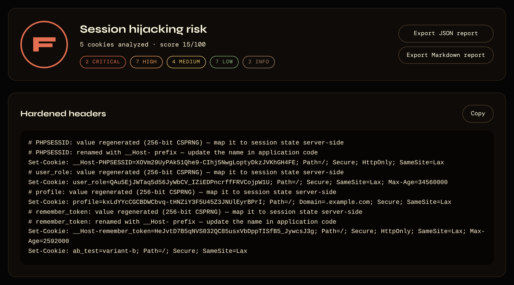
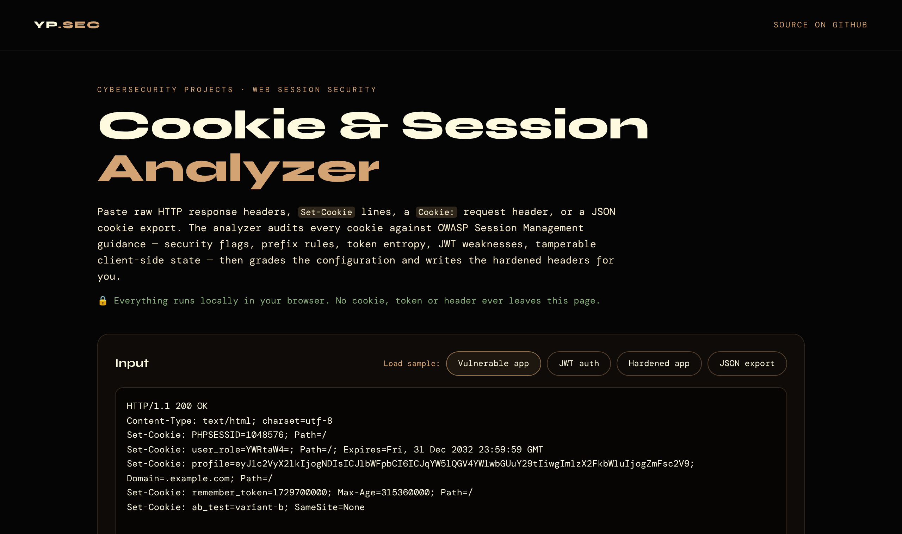
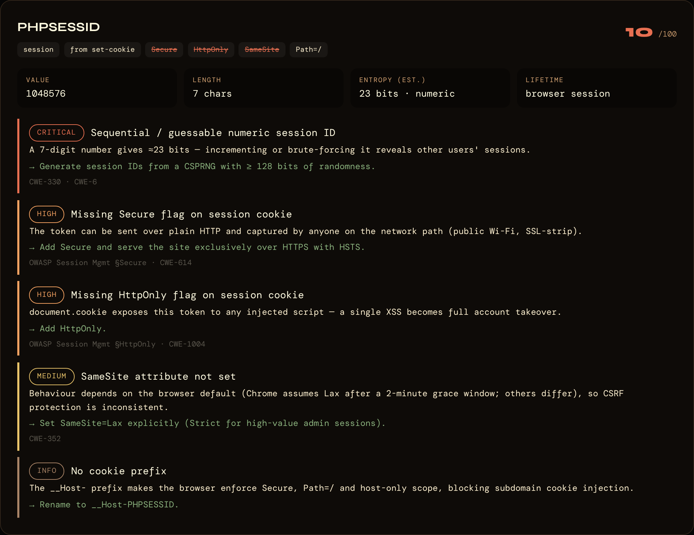
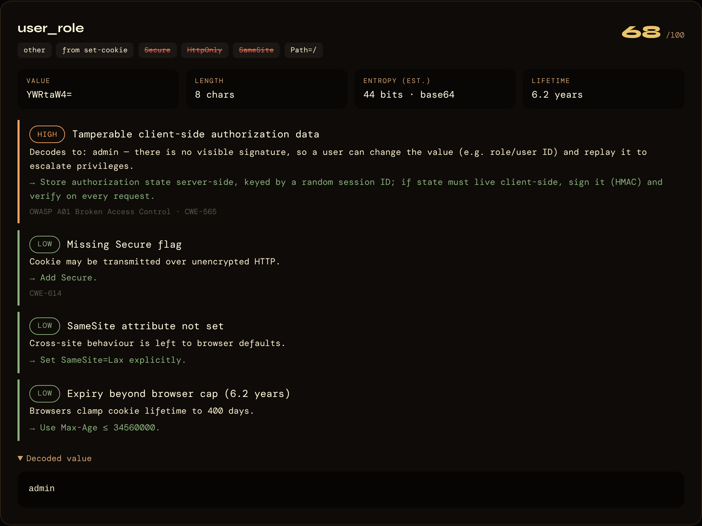
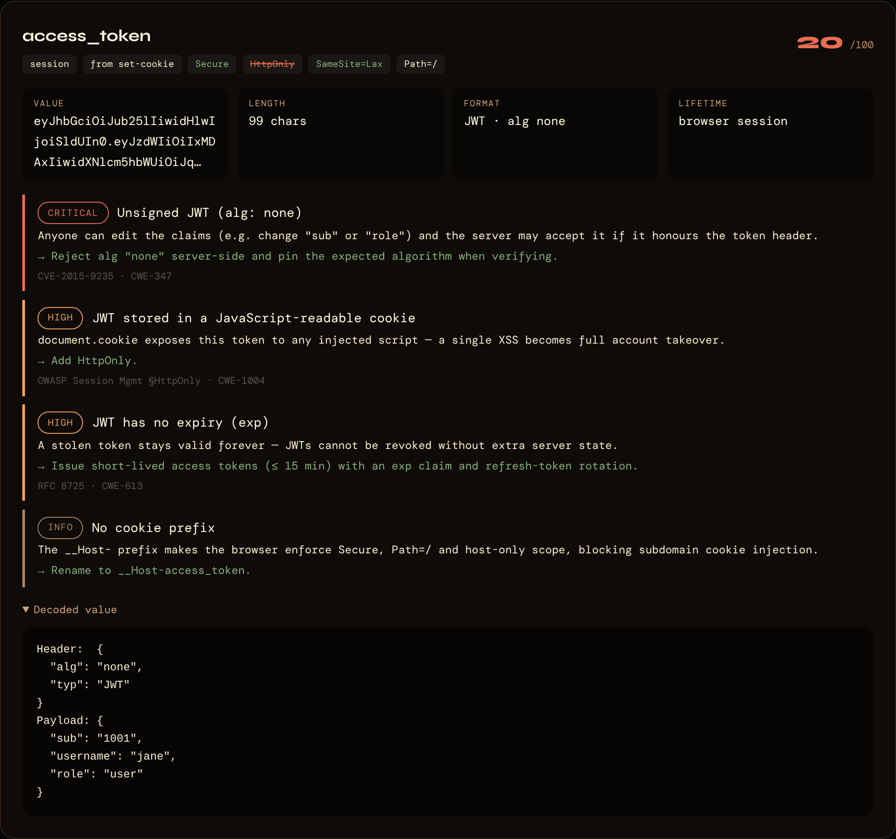
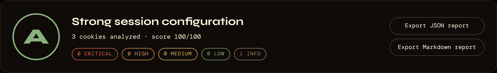
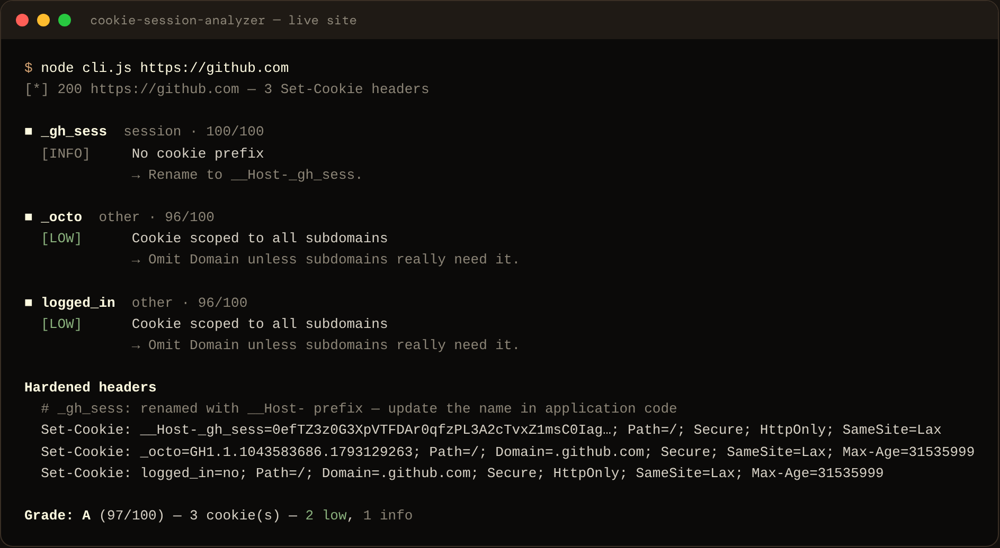
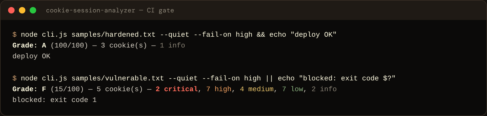
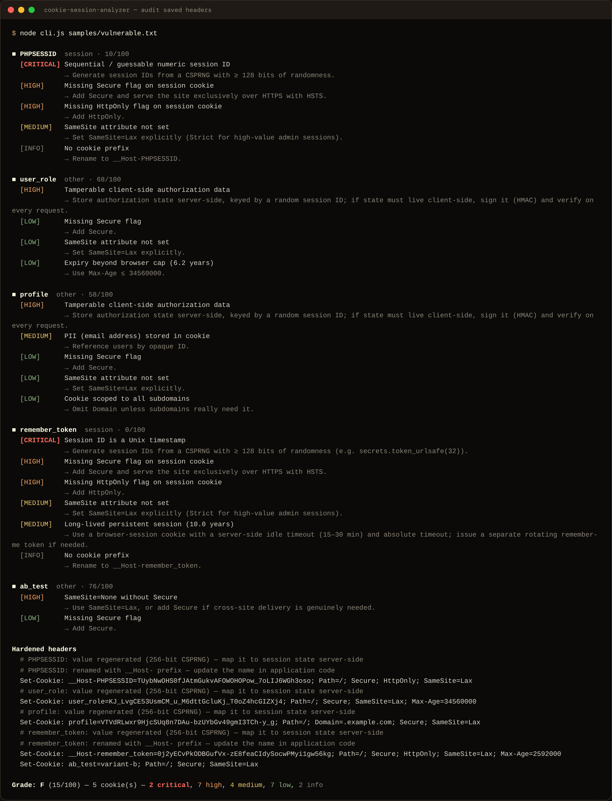

# Cookie & Session Analyzer

A tool that audits the cookies a web app sets: session-security flags, cookie scope, token randomness, JWT weaknesses and client-side state a user could tamper with. It grades the setup A–F and writes the corrected `Set-Cookie` headers for you. It comes as a **command-line tool** that can fetch a live site's cookies, and as a **browser tool** that runs entirely client-side.

**References:** OWASP Session Management Cheat Sheet · OWASP A01/A07 · RFC 6265bis · RFC 8725 (JWT BCP)
**CWE coverage:** 614, 1004, 352, 330/331, 613, 565, 347, 312, 359



---

## Why this project

Session cookies are the keys to every logged-in account. A single missing flag turns an ordinary bug into account takeover:

- no `HttpOnly` → one XSS steals every session
- no `Secure` → the token leaks over plain HTTP on public Wi-Fi
- a numeric or timestamp session ID → an attacker counts their way into other users' sessions
- `role=YWRtaW4=` (base64 for `admin`) → a user edits the cookie and becomes an admin

Scanners like Burp flag some of these. Building the checks myself meant understanding *why* each one matters, how browsers actually enforce `SameSite` and the `__Host-` prefix, and how to estimate whether a token is random enough to resist guessing.

## What it checks

| Area | Checks |
|---|---|
| Transport & script access | Missing `Secure` / `HttpOnly` on session cookies, session tokens readable through `document.cookie` |
| CSRF | Missing or invalid `SameSite`, `SameSite=None` without `Secure` (browsers reject it), session cookies sent on cross-site requests |
| Scope | `Domain=` exposing the session to every subdomain (cookie tossing), `__Host-` / `__Secure-` prefix violations that browsers silently drop |
| Lifetime | Persistent session tokens, multi-year expiry, expiry past the browser's 400-day cap |
| Token strength | Entropy estimate vs. OWASP's 64-bit minimum (128-bit recommended), sequential numeric IDs, Unix-timestamp IDs, repetitive tokens |
| JWT | Decodes header and payload: `alg: none` / unsigned, no `exp`, long-lived tokens, risky `jku`/`x5u`/`kid`, secrets or PII in claims, HMAC secret-strength warning |
| Client-side state | Base64, URL-encoded or JSON values carrying roles, user IDs, admin flags or emails, distinguishing unsigned (tamperable) from signed-but-readable (Flask / itsdangerous style) |

Each cookie is sorted into **session**, **CSRF**, **tracking** or **other** first, so a missing `HttpOnly` on a session token is reported as high severity while the same thing on a `theme` cookie isn't flagged at all.

## How it works: walkthrough

### 1. Paste what the server sends

Paste raw response headers (from DevTools → Network, Burp, or `curl -I`), `document.cookie` output, or a cookie export, or click a sample. Lines that aren't cookies, like `Content-Type`, are ignored.



### 2. Get an overall grade and the fixed headers

Every cookie is scored out of 100 and the whole setup gets an A–F grade: any critical finding means F, any high finding caps it at C. Underneath, the tool writes a corrected `Set-Cookie` line for each cookie and notes what changed (new random token, `__Host-` rename, persistence removed). The report can be downloaded as JSON or Markdown (see the screenshot at the top of this page).

### 3. See exactly what is wrong with each cookie

Each finding comes with a severity, why it matters, how to fix it, and an OWASP/CWE reference. Here a 7-digit numeric session ID is flagged critical because an attacker can simply count through other users' sessions.



### 4. Decode what's hidden inside the value

Base64, URL-encoded and JSON values are decoded automatically. `user_role=YWRtaW4=` turns out to be `admin` with no signature, so anyone can edit it and replay it.



JWTs are split into header and payload. This one uses `alg: none`, meaning it's unsigned, so the claims can be forged:



### 5. Confirm the fix

Run the hardened headers back through the tool and they come out clean:



### Command line: live sites and CI

The CLI runs the same checks on a real site. Below, it audits **github.com** live:



With `--fail-on`, it blocks a deploy when a cookie regresses:



## Project structure

```
cookie-session-analyzer/
├── analyzer.js          # core engine: parser, checks, entropy, JWT decoding, hardening, reports
├── cli.js               # command-line front end (live URL / file / stdin)
├── web/
│   ├── index.html       # browser front end, runs 100% client-side
│   └── analyzer.css
├── samples/             # vulnerable, JWT, hardened and browser-export inputs
├── screenshots/         # images used in this README
├── test/analyzer.test.js
└── package.json
```

One engine (`analyzer.js`) drives both the command-line tool and the web page. There are **no dependencies**: Node 18.14+ for the CLI, any modern browser for the web page.

## Usage

### Command line

Audit a live site (follows redirects and collects cookies from every hop):
```bash
node cli.js https://example.com
```

Audit headers saved from Burp / DevTools, or piped from curl:
```bash
node cli.js samples/vulnerable.txt
curl -sI https://example.com | node cli.js -
```

Export reports and use it as a CI gate:
```bash
node cli.js https://staging.myapp.com --json report.json --md report.md --fail-on high
```

| Flag | Description | Default |
|---|---|---|
| `<target>` | URL, file path (headers or JSON export), or `-` for stdin | — |
| `--json <file>` | Write a JSON report | none |
| `--md <file>` | Write a Markdown report | none |
| `--fail-on <sev>` | Exit code 1 if any finding is ≥ `critical` / `high` / `medium` / `low` | off |
| `--max-redirects <n>` | Redirect hops to follow for URLs | 5 |
| `-q`, `--quiet` | Print only the grade line | off |

### Browser

Open `web/index.html` (or serve the folder with `python -m http.server`) and paste any of these:

- raw HTTP response headers or `Set-Cookie` lines
- a `Cookie:` request header
- the output of `copy(document.cookie)` from DevTools: any session token that shows up there can already be read by an XSS payload
- a JSON cookie export (EditThisCookie / Cookie-Editor / Playwright `storageState`)

Nothing leaves the browser. Results can be exported as JSON or Markdown.

## Sample output

Full CLI report for `samples/vulnerable.txt`:



Results across the bundled samples:

| Input | Grade | Key findings |
|---|---|---|
| `samples/vulnerable.txt` | **F** (15) | numeric + timestamp session IDs, base64 `admin` role cookie, PII in cookie, 10-year session |
| `samples/jwt.txt` | **F** (30) | `alg: none` JWT, no `exp`, JWTs readable by JavaScript, email in claims |
| `samples/export.json` | **C** (80) | `SameSite=None` session shared across subdomains, tamperable `user_id` in cart cookie |
| `samples/hardened.txt` | **A** (100) | `__Host-` session with `Secure; HttpOnly; SameSite=Lax` |
| `https://github.com` (live) | **A** (97) | only low-severity notes on non-session cookies |

## Testing

```bash
npm test     # or: node --test
```

The tests cover the parsers (raw headers, `document.cookie`, JSON exports), every sample's grade and key findings, `__Host-` prefix rules, the entropy estimate, and a round-trip check that **every generated hardened header passes its own audit with 100/100**.

Only point the live-URL mode at sites you own or have permission to test. It sends ordinary GET requests, but make that a habit anyway.

## Design decisions (interview talking points)

- **Entropy estimate that doesn't lie on short strings.** Shannon entropy of a 22-character sample is capped by its length, so a truly random token looks weak. The estimate takes `length × log2(alphabet size)` and scales it by how close the observed character distribution gets to the best achievable for that length. Random tokens keep their full value, while `abab…` or `aaaa…` collapse toward zero.
- **Classify first, then judge severity.** Missing `HttpOnly` is high severity on a session token, deliberately allowed on a double-submit CSRF token, and irrelevant on a `theme` cookie. Context-free checks would bury the real problems in noise.
- **Signed vs. unsigned client-side state.** A Flask session cookie (`payload.timestamp.signature`) is readable but tamper-proof, so it's medium (information disclosure). A bare base64 `role` cookie can be edited and replayed, so it's high (broken access control).
- **Fixes, not just findings.** Every cookie gets a corrected header. Weak tokens are replaced with a fresh 256-bit `crypto.getRandomValues` value, session cookies get the `__Host-` prefix, and the side effects (rename, persistence removed) are spelled out so a developer knows what else to change.
- **Manual redirect following.** Login and geo redirects often set cookies on an intermediate 302 that `fetch` would silently skip. The CLI follows each hop itself and audits cookies from all of them.
- **One engine, two front ends, zero dependencies.** The same `analyzer.js` runs in Node and the browser, so the web demo and the CLI can never disagree, and there's no supply chain to audit.

## Possible extensions

- Active checks: replay the session after logout to test server-side invalidation, and log in twice to confirm the session ID rotates (session fixation)
- Collect many tokens from repeated logins and run statistical randomness tests on them (in the spirit of Burp Sequencer)
- Crack HS256 JWT secrets against a small wordlist to prove weak-secret findings
- SARIF output for GitHub code-scanning integration
